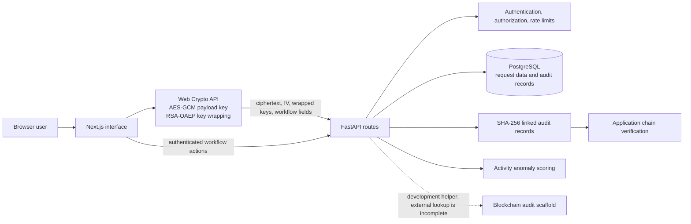

# AegisVault

[](https://www.python.org/)
[](https://fastapi.tiangolo.com/)
[](https://nextjs.org/)
[](https://www.postgresql.org/)
[](https://www.docker.com/)

AegisVault is a browser and API application for submitting, approving, and delegating requests. On the encrypted submission route, the browser encrypts the request body before upload. The API still receives account and workflow information such as authentication, request type, approver references, timestamps, and the encryption envelope metadata.

## Architecture



## Features

- Encrypts selected request payloads in the browser with AES-GCM and a random 256-bit data key.
- Wraps that key separately for approvers with RSA-OAEP and SHA-256; the server stores the submitted ciphertext and envelope fields.
- Supports account authentication, time-based one-time passwords, approval workflows, delegation, and request audit records.
- Stores linked audit hashes and provides an application endpoint to verify chain links and record contents.
- Includes activity anomaly scoring and rate limits for API requests.
- Includes a blockchain audit prototype with mock behavior; it is not a complete external anchoring and retrieval system.

## Results

The backend test suite completed with **120 passed and 10 skipped** using the repository's available Python environment and `DEBUG=false`. The 10 database integration tests skipped because the separate test database was unavailable. The initial test run without the override could not collect API tests because the local `.env` sets `DEBUG` to the non-boolean value `release`.

No production security audit, external blockchain verification result, or deployment measurement is claimed here.

## Quick Start

### Docker Compose

Set valid local values in `.env` for the database password and application secrets, then start the services:

```powershell
docker compose up -d
```

The compose file maps the web application to `http://localhost:3000`, the API to `http://localhost:8000`, API documentation to `http://localhost:8000/docs`, and PostgreSQL to port `5433` on the host.

### Local development

Start PostgreSQL first, for example with `docker compose up -d db`. In a second terminal, install and start the API:

```powershell
cd backend
python -m venv .venv
.\.venv\Scripts\Activate.ps1
$env:DEBUG = 'false'
python -m pip install -r requirements.txt
alembic upgrade head
uvicorn app.main:app --reload --host 0.0.0.0 --port 8000
```

Then start the frontend in another terminal:

```powershell
cd frontend
npm install
npm run dev
```

Open `http://localhost:3000`. The API requires valid `DATABASE_URL`, `SERVER_MASTER_KEY`, and `JWT_SECRET` settings. Do not use the development fallback values for a public deployment.

## Technical Design

### Encrypted request payloads

The browser serializes the selected request content, generates a random AES-GCM key and initialization vector, encrypts the content, then wraps the key for each listed approver using RSA-OAEP with SHA-256. It submits the ciphertext, initialization vector, key hash, request type, anonymity flag, and wrapped keys. The server can route and audit the request without decrypting that particular payload through the encrypted-request route. This does not hide the user's authenticated activity or all request metadata from the service.

The browser key pair is RSA-3072. The backend also has RSA-OAEP key wrapping and RSA-PSS with SHA-256 for server-side workflow signatures. Account private-key material is stored encrypted using a password-derived vault key. Other workflow paths use server-side encryption, so the browser-encrypted route should not be treated as a property of every stored field.

### Audit and blockchain code

Audit entries include a SHA-256 hash linked to the prior entry. The verifier can detect changed entry data or broken links when it is run against the stored chain. The hash chain does not prevent database edits or independently prove which version existed before verification.

The blockchain service contains a local development transaction path and a mock service. The real service's record lookup currently returns no records, so the repository does not provide end-to-end external anchor verification. The audit database is not immutable, and working EVM testnet anchoring is not demonstrated.

### Application components

| Part | Implementation |
|---|---|
| Browser | Next.js 16, TypeScript, Web Crypto API |
| API | FastAPI, Python, Pydantic, SQLAlchemy |
| Database | PostgreSQL through async SQLAlchemy and asyncpg |
| Security | AES-GCM for browser payloads; RSA-OAEP for key wrapping; RSA-PSS signatures in backend workflows; TOTP support |
| Activity analysis | scikit-learn anomaly scoring over application activity features |

## Tests

From `backend/`, run the test suite with the local setting override:

```powershell
$env:DEBUG = 'false'
python -m pytest tests/ -v -p no:cacheprovider
```

On macOS or Linux, use `DEBUG=false python -m pytest tests/ -v -p no:cacheprovider`. The latest run completed with **120 passed and 10 skipped**. The encrypted-request tests exercise submission, envelope validation, approver-only retrieval, and AES-GCM/RSA-OAEP decryption with a test database stub. The request-detail API returns browser-encrypted content as unavailable to server-side decryption, allowing the approver page to decrypt it in the browser. The 10 database integration tests still require the separate test database. These are software tests, not a security audit.

## License

MIT License

Copyright (c) [2026] [Schrodi-Ø-Ao]

Permission is hereby granted, free of charge, to any person obtaining a copy
of this software and associated documentation files (the "Software"), to deal
in the Software without restriction, including without limitation the rights
to use, copy, modify, merge, publish, distribute, sublicense, and/or sell
copies of the Software, and to permit persons to whom the Software is
furnished to do so, subject to the following conditions:

The above copyright notice and this permission notice shall be included in all
copies or substantial portions of the Software.

THE SOFTWARE IS PROVIDED "AS IS", WITHOUT WARRANTY OF ANY KIND, EXPRESS OR
IMPLIED, INCLUDING BUT NOT LIMITED TO THE WARRANTIES OF MERCHANTABILITY,
FITNESS FOR A PARTICULAR PURPOSE AND NONINFRINGEMENT. IN NO EVENT SHALL THE
AUTHORS OR COPYRIGHT HOLDERS BE LIABLE FOR ANY CLAIM, DAMAGES OR OTHER
LIABILITY, WHETHER IN AN ACTION OF CONTRACT, TORT OR OTHERWISE, ARISING FROM,
OUT OF OR IN CONNECTION WITH THE SOFTWARE OR THE USE OR OTHER DEALINGS IN THE
SOFTWARE.